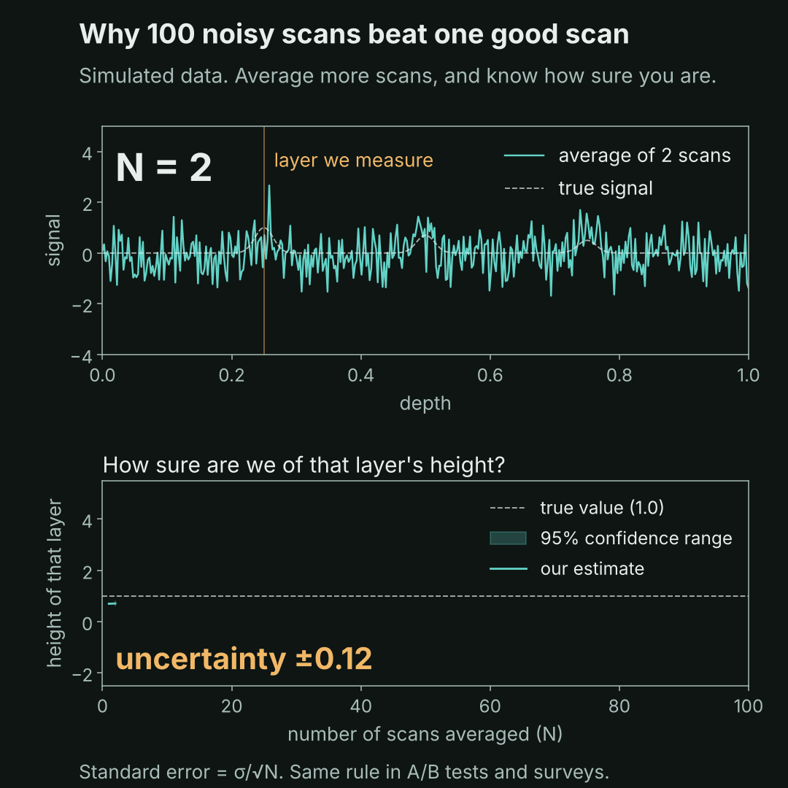

# 1. Averaging noisy scans: standard error

Every scan has random noise. Average N scans and the noise in the average shrinks by √N. This is the standard error of the mean: SE = σ/√N. Four times the data gives half the uncertainty.



## What the code does

1. Builds a depth profile with three reflecting layers (the true signal).
2. Simulates 100 scans: the true signal plus independent random noise (σ = 1).
3. Takes the reading at the first layer's peak in every scan and averages the first N of them.
4. Gives a 95% confidence interval for that average (t-interval, standard error from the data).

| Scans (N) | 95% interval half-width |
|---|---|
| 4 | ±1.08 |
| 16 | ±0.48 |
| 64 | ±0.21 |
| 100 | ±0.17 |

True height is 1.0, and the estimate after 100 scans is 1.08.

Planning rule: for a margin of ±0.2 at σ = 1 you need about (1.96 × σ / 0.2)² ≈ 96 scans, before you collect anything.

## Run it

```
python standard_error.py
```

This writes `standard_error.gif` and `before_after.png` next to the script. Try changing `noise_sigma` or `n_scans` near the top of the file.

## Limit

Only random noise averages away like this. Speckle in OCT is identical when the same spot is scanned again, so it needs scans that are independent of each other (post 3).
