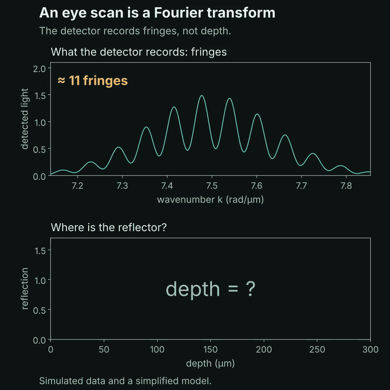

# 2. How OCT turns fringes into depth: the Fourier transform

In optical coherence tomography (OCT) the detector records light across many wavelengths. A reflector at depth z makes fringes in that spectrum, and the deeper it is, the faster the fringes oscillate. A Fourier transform (FFT) reads the fringe speed and gives the depth. That is the whole step from "wiggly signal" to "image of the eye".



## What the code does

1. Simulates a spectrometer: 1024 wavenumbers k for wavelengths from 800 to 880 nm, and a bell-shaped light source.
2. Builds the detected spectrum: the source spectrum with one fringe pattern per reflector.
3. Subtracts the source background and takes the FFT. Bin number is turned into depth with z = π · bin / (n_fft · Δk).
4. Prints a check: the FFT peak lands on the true depth.

| True depth | FFT peak |
|---|---|
| 40 µm | 40.1 µm |
| 100 µm | 100.1 µm |
| 150 µm | 150.1 µm |
| 220 µm | 220.0 µm |

Two reflectors give two peaks, and a weaker reflector gives a smaller peak (0.6 times as high in the animation).

## Run it

```
python fourier_oct.py
```

This writes `fourier_oct.gif` next to the script. Try changing the depths in the `frames` section, or `n_points` near the top.

## Limit

The deepest depth you can measure is π / (2 · Δk), here about 2250 µm. Deeper reflectors make fringes too fast to sample, and their peaks wrap back to the wrong depth. This is aliasing, the topic of a later post (Nyquist).

The signal is simulated and simplified: one clean reflection per layer, no noise, no dispersion.
